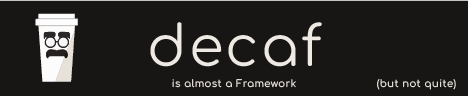

## Typescript Template

This repository is meant to provide an enterprise template for any standard Typescript project

Documentation [here](https://decaf-ts.github.io/for-react/), Test results [here](https://decaf-ts.github.io/for-react/workdocs/reports/html/test-report.html) and Coverage [here](https://decaf-ts.github.io/for-react/workdocs/reports/coverage/lcov-report/index.html)

### Description

No one needs the hassle of setting up new repos every time.

Now you can create new repositories from this template and enjoy having everything set up for you.

### How to Use

- [Initial Setup](./workdocs/tutorials/For%20Developers.md#_initial-setup_)
- [Installation](./workdocs/tutorials/For%20Developers.md#installation)
- [Scripts](./workdocs/tutorials/For%20Developers.md#scripts)
- [Linting](./workdocs/tutorials/For%20Developers.md#testing)
- [CI/CD](./workdocs/tutorials/For%20Developers.md#continuous-integrationdeployment)
- [Publishing](./workdocs/tutorials/For%20Developers.md#publishing)
- [Structure](./workdocs/tutorials/For%20Developers.md#repository-structure)
- [IDE Integrations](./workdocs/tutorials/For%20Developers.md#ide-integrations)
  - [VSCode(ium)](./workdocs/tutorials/For%20Developers.md#visual-studio-code-vscode)
  - [WebStorm](./workdocs/tutorials/For%20Developers.md#webstorm)
- [Considerations](./workdocs/tutorials/For%20Developers.md#considerations)

### Subpath exports

- [`@decaf-ts/for-react/code-editor`](./src/code-editor/README.md) — CodeMirror 6
  code/formula editor built on `@uiw/react-codemirror`. Importing the subpath is
  the only thing that loads CodeMirror; the root package does not include it.
- [`@decaf-ts/for-react/gantt`](./src/gantt/README.md) — Typed Gantt timeline
  adapter over the dhtmlx-gantt Community renderer. Importing the subpath is
  the only thing that loads the renderer; the root package does not include it.

### Dashboard builder demo

The demo app served by `npm run dev` (`http://localhost:8111`) ships a
`/dashboard-builder` route (sidebar entry "Dashboard Builder") exercising
`RgxDashboard` over a 4×4 grid with localStorage persistence — no backend
needed.

| Mode | Behaviour |
| --- | --- |
| Create | Empty 4×4 canvas; palette buttons insert a component into the first free cell; Save persists and switches to Read |
| Read | Renders the saved composition with no editing affordances (empty message when nothing is stored) |
| Update | Edits the saved composition; Save persists and switches to Read |
| Delete | Exposes the Delete button; deleting clears the stored composition and returns to Create |

The composition is stored in `localStorage` under the key
`dashboard-builder:composition` as a `DashDocument` JSON
(`{ name, cols, rows, placements }`); Read/Update/Delete load it on entry and
fall back to an empty document when the key is missing. A "Dashboard saved."
confirmation is announced after each save.

Palette components (registered in `RgxComponentRegistry` by the demo page):

| Tag | Label | Default size | Default config |
| --- | --- | --- | --- |
| `demo-stats` | Stat | 2×1 | `{ title: "Revenue", value: "$12,480" }` |
| `demo-list` | List | 2×2 | `{ title: "Top items", items: ["Alpha", "Bravo", "Charlie"] }` |
| `demo-note` | Note | 1×1 | `{ note: "Remember to review the composition." }` |

Editing (Create/Update): drag a tile by its header to move it and use the
corner handle to resize — both gestures snap to the grid and are rejected on
collision or out-of-bounds; the × button removes a tile after an explicit
confirm. Keyboard: tiles are focusable in edit modes (`role="group"`,
`tabindex="0"`) with an accessible position label ("Column {col}, row {row},
{cols} by {rows} cells") and a screen-reader hint; the arrow keys move the
focused tile one cell and Shift+Arrow resizes it, with invalid moves ignored.
Read mode removes every editing affordance, including tile focus.

Persisted compositions are restored through the public util
`restorePlacements(placements, allowedTags)`, exported from the root
`@decaf-ts/for-react` package: placements whose `tag` is not in the current
palette whitelist are dropped on restore, and prototype-pollution keys
(`__proto__`, `constructor`, `prototype`) are stripped from both the placement
and its `config`, so a tampered stored document cannot instantiate unregistered
components.

This is not a subpath export: the dashboard lives in the root package
(`src/lib/components/dashboard/`), so no export README under `src/` is needed.

End-to-end coverage runs through the minimal Playwright harness:
`npm run playwright` (alias `test:e2e`) boots the Vite dev server (port `8111`,
override with `FOR_REACT_E2E_PORT`) and runs the specs under
`tests/playwright/`; the Jest `test:all` suite excludes that folder. The
behaviour is additionally covered by `tests/unit/dashboard-parity.spec.tsx` and
`tests/integration/dashboard-builder-demo.spec.tsx`.

### Related

### Social

#### Languages

## Getting help

If you have bug reports, questions or suggestions, please [create a new issue](https://github.com/decaf-ts/ts-workspace/issues/new/choose).

## Contributing

I am grateful for any contributions made to this project. Please read [this](./workdocs/98-Contributing.md) to get started.

## Supporting

The first and easiest way you can support it is by [Contributing](./workdocs/tutorials/Contributing.md). Even just finding a typo in the documentation is important.

Financial support is always welcome and helps keep both me and the project alive and healthy.

So if you can, if this project in any way. either by learning something or simply by helping you save precious time, please consider donating.

## License

This project is released under the [MIT License](./LICENSE.md).

By developers, for developers...